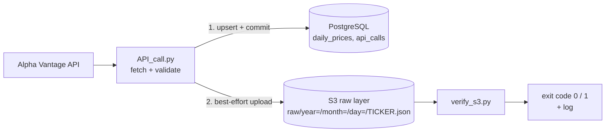

# Daily API-Based Data Collector


An idempotent batch pipeline that pulls daily stock prices from the Alpha
Vantage API, loads them into PostgreSQL, and keeps every raw API response in an
AWS S3 data lake. A separate verification script checks what landed in S3 and
reports the result through its exit code, ready for a scheduler.

This repository is part of a data engineering portfolio series. The projects
build on each other, so they share one codebase; each finished stage is marked
with a git tag.

| Stage | Project | What it adds | Tag |
|---|---|---|---|
| 2 | Daily API collector | live API → PostgreSQL, idempotent upsert, quota tracking, tests | `v0.2-api-collector` |
| 3 | Data lake on S3 | raw layer in S3, least-privilege IAM, upload verification | `v0.3-data-lake` |
| 4 | Serverless ETL | Glue / Athena processing of the raw layer *(next)* | |

Design rationale lives in two design docs:
[`docs/design-doc.md`](docs/design-doc.md) (collector, project 2) and
[`docs/data-lake-design.md`](docs/data-lake-design.md) (data lake, project 3).
This README covers what the project does and how to run it.

## Architecture



One run handles one ticker and then stops. Everything the pipeline needs to
decide what to do next (how many API calls were made today, which rows already
exist) lives in the database, not in memory.

## What It Demonstrates

- **Idempotency.** The load is an upsert on `(ticker, trade_date)`. Re-running
  the collector for the same day never creates duplicates. In S3, a same-day
  re-run overwrites that day's object.
- **Fault tolerance with explicit error types.** Network errors are retried with
  backoff, a quota breach is a planned stop, and an S3 outage is logged without
  undoing the database load. Programming errors are never swallowed.
- **Content-based validation.** Alpha Vantage returns `200 OK` with valid JSON
  even on a quota breach, so success is judged by the response content, not by
  the status code.
- **A raw layer as a contract.** The S3 key format is built in one function,
  shared by the writer and the verifier, and guarded by a test.
- **Least-privilege access.** A dedicated IAM user can only reach the `raw/`
  prefix of the bucket.
- **Observable runs.** Every outcome is logged once, with the object key and
  the reason of a failure; the verifier's exit code is what a scheduler acts on.

## Key Design Decisions

| Decision | Rationale |
|---|---|
| Upsert (`ON CONFLICT ... DO UPDATE`), not delete-then-insert | atomic, race-condition-free, one round trip |
| Success judged by response *content* | a quota breach also returns `200 OK` and valid JSON |
| API call log in its own table (`api_calls`) | single source of truth; the quota is counted from it, in the same transaction as the load |
| S3 upload after the database commit, best-effort | the primary load must not depend on S3 availability |
| S3 partitions by run date in UTC | the raw layer stores what was received and when; UTC matches the quota counting |
| `ListBucket` allowed on the `raw/` prefix | without it S3 reports a missing object as `AccessDenied`, not `NoSuchKey` |
| TLS through a scoped `truststore` context and `AWS_CA_BUNDLE` | works behind a TLS-inspecting corporate proxy without disabling certificate verification |

The full list, with the alternatives considered, is in the design docs.

## Data Source

[Alpha Vantage](https://www.alphavantage.co/), free tier, `TIME_SERIES_DAILY`
endpoint (about 100 trading days per response). The free tier allows 25
requests per day; the collector tracks this limit itself before each call.

## Prerequisites

- Python 3.14
- PostgreSQL 18.4
- An [Alpha Vantage API key](https://www.alphavantage.co/support/#api-key) (free)
- An AWS account with an S3 bucket and an IAM user as described in
  [`docs/data-lake-design.md`](docs/data-lake-design.md) (section 4)

## Installation

1. Clone the repository:
   ```bash
   git clone https://github.com/Maxid8/Daily-API-based-data-collector.git
   cd Daily-API-based-data-collector
   ```

2. Create and activate a virtual environment:
   ```powershell
   python -m venv .venv
   .venv\Scripts\Activate.ps1   # Windows
   ```

3. Install the pinned dependencies:
   ```bash
   pip install -r requirements.txt
   ```

4. Create your `.env` file from the template and fill in the API key, the
   PostgreSQL credentials, the AWS credentials and the bucket name:
   ```bash
   cp .env.example .env
   ```

5. Create the database schema:
   ```bash
   psql -U your_user -d your_database -f sql/table.sql
   ```

**Behind a TLS-inspecting corporate proxy:** boto3 does not use the operating
system's certificate store. Set `AWS_CA_BUNDLE` in `.env` to a PEM file that
contains botocore's default CA list plus your proxy's CA certificates. Details
are in [`docs/data-lake-design.md`](docs/data-lake-design.md), section 4.6.

## Usage

### Collect prices

```bash
python src/API_call.py --ticker IBM
```

This checks the daily quota, fetches the prices, upserts them into
PostgreSQL, and uploads the raw response to
`raw/year=YYYY/month=MM/day=DD/IBM.json` in S3.

For development without spending API quota, replay a saved response. In this
mode nothing is uploaded to S3, because a saved fixture is not what the API
returned on that day:

```bash
python src/API_call.py --ticker IBM --fixture tests/fixtures/daily_series_success.json
```

### Verify the upload

```bash
python src/verify_s3.py --ticker IBM                    # today (UTC)
python src/verify_s3.py --ticker IBM --date 2026-10-12  # a given day
```

The verifier checks that the object exists, is a JSON object, contains the
daily time series, and belongs to the requested ticker.

| Exit code | Meaning |
|---|---|
| `0` | every check passed (`Raw object verified: ...`) |
| `1` | a check failed; the log line names the check and the object key |

Example of a failed run:

```
ERROR verify_s3: Raw object not found: raw/year=2026/month=10/day=12/MSFT.json
```

## Testing

```bash
pytest -v
```

36 unit tests cover the collector, the S3 upload and the verifier. PostgreSQL,
the Alpha Vantage API and S3 are replaced by mocks, so the suite runs without
a database, network access or API quota.

| Test file | Covers |
|---|---|
| `tests/test_API_call.py` | response validation, call logging, the upsert, the quota check, retry with backoff, and when the S3 upload is or is not triggered |
| `tests/test_s3_writer.py` | the partition key format, a successful upload, both S3 error families, and that programming errors are not swallowed |
| `tests/test_verify_s3.py` | the content checks, and every exit path of the verifier, checked for both its return value and its log message |

Two real Alpha Vantage responses in `tests/fixtures/` back several tests:
a successful `TIME_SERIES_DAILY` response and the error returned for an
invalid API key.

Verified manually against real PostgreSQL and AWS:

- a run upserts the expected rows and uploads the raw response;
- a same-day re-run keeps the row count and overwrites the S3 object;
- once the daily limit is reached, further runs stop before calling the API;
- the verifier passes for an existing object and fails with the right message
  for a missing one.

## Project Structure

```
Daily-API-based-data-collector/
├── docs/
│   ├── design-doc.md            # project 2: collector design and decisions
│   └── data-lake-design.md      # project 3: S3 raw layer, IAM, verification
├── sql/
│   └── table.sql                # daily_prices and api_calls schema
├── src/
│   ├── API_call.py              # collector: quota, fetch, validate, upsert, upload
│   ├── s3_writer.py             # S3 client, raw-layer key, best-effort upload
│   └── verify_s3.py             # verifies one raw-layer object, exit code 0/1
├── tests/
│   ├── fixtures/
│   │   ├── daily_series_success.json
│   │   └── invalid_api_key.json
│   ├── test_API_call.py
│   ├── test_s3_writer.py
│   └── test_verify_s3.py
├── .env.example
├── .gitignore
├── pytest.ini
├── requirements.txt
└── README.md
```

## Lessons Learned

**Project 2.** The API integration and the database insertion came together
faster than expected. The bigger challenge was designing a clean function
structure, where each function has a single, clear responsibility. If I
restarted, I would spend more time in the design phase before writing code.
Upsert semantics and transactions were new to me; I understand the reasoning
now, but I want to keep practicing them.

**Project 3.** Unit tests with mocks proved the logic but not the integration:
the first real run uncovered two problems that no unit test could see, an
import-order conflict between two TLS libraries and a corporate proxy
certificate. I also learned that a green test is not necessarily a good test.
One of mine passed for the wrong reason until I removed a catch-all `except`.
Since then I deliberately break the code to check that each test can fail.

## Note

This project was built for learning purposes, as part of a personal data
engineering portfolio series. Feedback is welcome, but it isn't maintained as
an actively developed, production-ready project.
